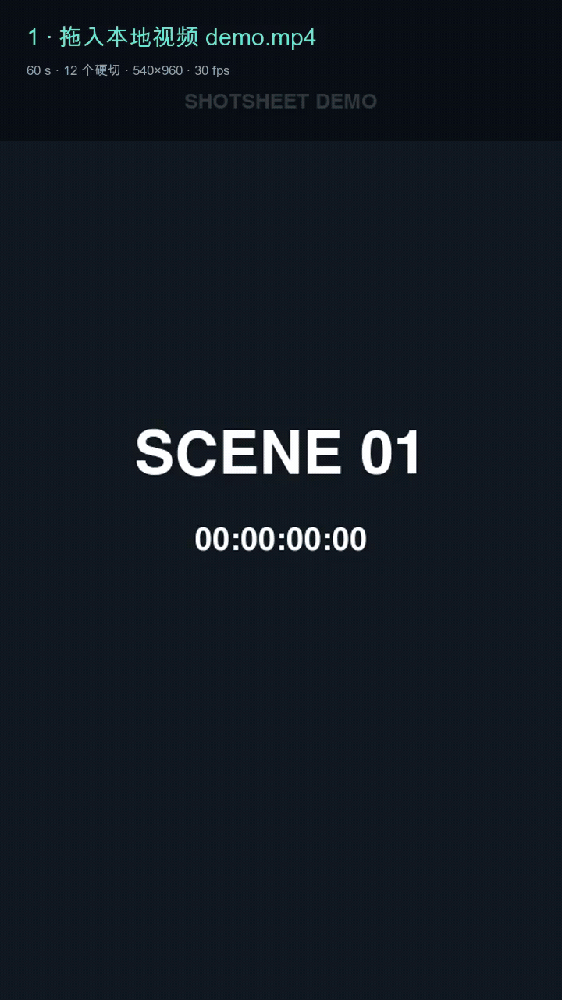

**English** | [简体中文](./README.md)

<p align="center">
  <picture>
    <source media="(max-width: 640px) and (prefers-color-scheme: dark)" srcset="assets/hero-mobile-dark.svg">
    <source media="(max-width: 640px)" srcset="assets/hero-mobile-light.svg">
    <source media="(prefers-color-scheme: dark)" srcset="assets/hero-dark.svg">
    
  </picture>
</p>

<p align="center">
  <a href="https://github.com/SuperMarioYL/shotsheet/actions/workflows/ci.yml"></a>
  
  
  
  
</p>

**ShotSheet turns a reference short video into a shot list you can actually shoot from: every shot carries its source timecode, duration, shot size, camera placement, movement, props and scene. It checks the planned subtitle band and opening hook against Douyin, Xiaohongshu and WeChat Channels rules, then exports a reference timeline you can open in Jianying.** Everything runs locally: no upload, no account.

## Why this exists

When you remake a hit video, the expensive part is not understanding it. It is translating the video into an executable shooting plan. The manual loop is pause, scrub back two seconds, pause again, write down the camera position, framing, props and how long each shot held. A 60-second clip takes one to two hours, and what comes out is a page only its author can read.

Per-shot teardown already exists as a product: [rea-video](https://github.com/JuneYaooo/rea-video) does the hard decomposition. But its `VIDEO.md` / `report.html` output is an intermediate format written for agents and developers. A creator still has to translate it into a shot list a photographer can follow. ShotSheet adds the execution contract: fixed fields, a `tc_in` on every row, rule ids tied to a platform, and a reusable Skill/template shape. The decomposition came first and we credit that work; what we add is the three-platform rule sheet, timecodes you can audit frame by frame, and a Jianying project export.

## Quickstart

This works from a fresh clone and creates its own input: a 6-second vertical clip with three hard cuts.

```bash
git clone https://github.com/SuperMarioYL/shotsheet.git
cd shotsheet
uv sync

# Build a three-shot test clip (needs the ffmpeg CLI)
ffmpeg -y \
  -f lavfi -i "color=c=0x101820:s=540x960:d=2:r=30" \
  -f lavfi -i "color=c=0xf2b134:s=540x960:d=2:r=30" \
  -f lavfi -i "color=c=0x17365f:s=540x960:d=2:r=30" \
  -filter_complex "[0:v][1:v][2:v]concat=n=3:v=1:a=0" \
  -pix_fmt yuv420p demo.mp4

# Detect cuts and timecodes, apply platform rules, write shots.json + a printable shots.html
uv run shotsheet analyze demo.mp4 --platform douyin -o shots.json
```

The terminal prints `3 shots -> shots.json`. Open the sibling `shots.html` in a browser to see the A4 shot sheet.

Then start the local single-page UI:

```bash
uv run shotsheet serve
# open http://127.0.0.1:8787
```

Shot size, camera, movement, props and scene are editable in the page, and every edit is written back to `shots.json` immediately. Vision descriptions need an ARK (Volcengine) or DashScope (Alibaba Cloud) key (`ARK_API_KEY` / `DASHSCOPE_API_KEY`), or you can paste one into the page for that request. Without vision you still get shot detection and rule checks.

## Demo

<p align="center">
  
</p>

The 16-second GIF above comes from a real run: a 60-second synthetic vertical clip with 12 hard cuts, analysed into 12 shots. Shot 1 received one warning for running past Douyin's 3-second hook window. The export then wrote 12 video segments and 60,000,000 µs of Jianying draft timeline. The GIF is assembled from real artifacts (clip frames, the generated `shotlist.html`, the actual `export --dry-run` output, and the written draft tree); it is not a screen recording.

The full commands, input generation, output counts and limitations are in [docs/demo-results.json](docs/demo-results.json).

## Architecture

<p align="center">
  <picture>
    <source media="(max-width: 640px) and (prefers-color-scheme: dark)" srcset="assets/architecture-mobile-dark.svg">
    <source media="(max-width: 640px)" srcset="assets/architecture-mobile-light.svg">
    <source media="(prefers-color-scheme: dark)" srcset="assets/architecture-dark.svg">
    
  </picture>
</p>

One process, one directory, no database. Each job gets a temporary working directory that can be deleted when it finishes.

- `pipeline/analyze.py`: `ffprobe` reads duration and frame rate, `scenedetect` finds shot boundaries, optional `faster-whisper` transcribes captions.
- `pipeline/describe.py`: samples a frame per shot and calls an OpenAI-compatible vision endpoint to fill shot size, camera, movement, props and scene. Doubao is the default; Qwen VL is the alternative.
- `pipeline/rules.py`: reads only `rules/cn-platforms.yaml` and checks duration, opening hook and the planned caption band. No platform number is hardcoded.
- `render/shotlist_html.py`: the A4 sheet with timeline, captions and rule columns; the web page reuses the same table markup for inline editing.
- `render/jianying.py`: converts `tc_in` / `tc_out` to microseconds and writes the Jianying draft project.

## Process

<p align="center">
  <picture>
    <source media="(max-width: 640px) and (prefers-color-scheme: dark)" srcset="assets/process-mobile-dark.svg">
    <source media="(max-width: 640px)" srcset="assets/process-mobile-light.svg">
    <source media="(prefers-color-scheme: dark)" srcset="assets/process-dark.svg">
    
  </picture>
</p>

Every stage leaves a file you can inspect instead of only returning a final answer: `shots.json` can be diffed, `shots.html` can be printed, and the Jianying folder can be audited shot by shot against the source.

## The shot sheet contract

A `ShotSheet` is the diffable record of one analysed clip:

```
ShotSheet
├─ source   file, duration_ms, fps, platform, caption_box
├─ rules    cn-platforms.yaml#douyin | #xiaohongshu | #shipinhao
├─ template optional saved sheet id
└─ shots[]
   ├─ index, tc_in "00:00:03:12", tc_out, duration_ms
   ├─ shot_size 特写|近景|中景|全景|远景
   ├─ camera    固定|手持|俯拍|仰拍|平视|过肩
   ├─ movement  推|拉|摇|移|跟|无
   ├─ props[], scene
   └─ caption   text, in_ms, out_ms, safe_area_ok
```

Two constraints make quality auditable: every field carries a `tc_in`, so a person can jump back to the exact frame in the source; and the whole sheet can be diffed, so changes between two versions of the same clip are visible.

## Capabilities and integrations

<p align="center">
  <picture>
    <source media="(max-width: 640px) and (prefers-color-scheme: dark)" srcset="assets/capabilities-mobile-dark.svg">
    <source media="(max-width: 640px)" srcset="assets/capabilities-mobile-light.svg">
    <source media="(prefers-color-scheme: dark)" srcset="assets/capabilities-dark.svg">
    
  </picture>
</p>

| Capability | v0.1 status | Notes |
| --- | --- | --- |
| Local file analysis | Implemented | mp4 / mov / mkv; v0.1 does not download Douyin, Xiaohongshu or Channels URLs |
| Cut detection and timecodes | Implemented | `scenedetect` plus real frame-rate conversion; `tc_in` goes back to the source |
| Local ASR captions | Implemented | `--transcribe`; the faster-whisper model downloads on first use |
| Per-shot vision description | Implemented | Doubao `doubao-seed-2-1-pro-260915`, switchable to Qwen `qwen3-vl-plus` |
| Three-platform rules | Implemented | Duration cap, opening hook, planned caption band; the YAML is the only source |
| Inline web editing | Implemented | Edits persist to `shots.json` immediately and re-run the rules |
| A4 shot sheet | Implemented | `shots.html`, A4 print layout |
| Jianying draft export | Implemented | Plaintext `draft_content.json`, one segment per shot, microsecond timing |
| Batch queue / shared templates / multi-account | Not implemented (v0.2 roadmap) | See Pricing |

## Platform rules and the subtitle band

`src/shotsheet/rules/cn-platforms.yaml` is the single source of platform rules. Duration limits cite public platform policy pages. The opening hook and subtitle safe areas are community-observed ranges marked `heuristic` in the file; they are not published platform specifications.

The default planned caption band is `top 72% / bottom 80% / left 6% / right 88%`, an 8%-tall strip. That rectangle stays inside the UI margins of all three shipped profiles (Douyin, Xiaohongshu, Channels), so the default does not report a violation. Both the CLI and the web page can change it:

```bash
uv run shotsheet analyze demo.mp4 --platform xiaohongshu --caption-box 70,80,8,86
uv run shotsheet rules shots.json --caption-box 88,100,4,96   # out of bounds example
```

Being explicit about the limitation: v0.1 cannot locate text already burned into the picture. The safe-area check validates `source.caption_box`, the **planned** band this tool would export, not the actual bounding box of text in the source. The rule id is `planned_caption_safe_area` for exactly that reason.

## Jianying export

```bash
# Inspect the plan first: canvas, tracks, timeline/source ranges for each segment; writes nothing
uv run shotsheet export shots.json --jianying-dir ./jianying --dry-run

# Write the draft directory and embed the source clip path
uv run shotsheet export shots.json --jianying-dir ./jianying --video demo.mp4
```

The output is a Jianying draft root:

```
jianying/
├─ root_meta_info.json
└─ demo-shotsheet/
   ├─ draft_content.json
   └─ draft_meta_info.json
```

Copy the `<draft-name>` folder into Jianying's `com.lveditor.draft` directory and merge the `all_draft_store` entry from `root_meta_info.json` into that directory's file to register the project. Each shot is one segment; `target_timerange` and `source_timerange` are both in microseconds. With no captions the draft has only a video track; with ASR captions it adds a text track positioned from the planned caption band.

**Target version:** plaintext `draft_content.json`, `version: 360000` and `new_version: "75.0.0"`, the format read by Jianying Professional 5.x/6.x. **Jianying 10.1 stores its timeline in an encrypted `draft_info.json`; this tool neither writes nor decrypts that file**, so do not treat this output as a 10.1-importable project. This build did not perform a live import inside a running Jianying install; the compatibility note is in [docs/demo-results.json](docs/demo-results.json). Cut alignment is computed exact from `tc_in`/`tc_out` to microseconds rather than estimated.

## Pricing

The v0.1 local edition has no paywall: it is MIT-licensed, and analysis, rule checks and exports are all usable locally. What is paid is the v0.2 team edition for small crews and MCNs:

| Plan | Price | Includes |
| --- | --- | --- |
| Local v0.1 | Free | Single-machine analysis, inline editing, three platform rule sets, HTML and Jianying export |
| Team v0.2 | ¥299 / month / team | 5 seats, 500 videos/month, batch queue (20 per run), shared template library, multi-account parallelism |
| Team annual | ¥2,990 / year | Same as above; overage ¥0.6 per video |
| Pilot teardown | ¥1,500 / run | A one-off batch teardown of ten of your hit videos, delivered as shot-sheet HTML and a Jianying project |

The team edition runs on a 2C4G Tencent Cloud Lighthouse instance and bills through a WeChat Pay merchant account. The shortest path to a first payment is not a SaaS signup: it is finishing this batch of videos, confirming the sheet is shootable, and then discussing private deployment or a monthly renewal. v0.1 does not sell accounts, cloud upload or a template marketplace; those commitments wait until v0.2 actually ships them.

## Roadmap

- **v0.1 (current):** local cut detection, timecodes, optional ASR, per-shot vision description, three platform rule sets, inline web editing, A4 shot sheet, plaintext Jianying draft export.
- **v0.2 (planned, not implemented):** batch queue (20 per run), shared template library, MCN multi-account parallelism, hosted upload; matches the team pricing above.
- **Not promised:** direct platform URL download, BGM/beat analysis, automatic Jianying effects and transitions, a template marketplace. The v0.1 boundary is local file in, shootable material out.

## Known limitations

- Vision models get shot size, camera and props wrong. Every cell is editable and every row goes back to `tc_in`; the value is cutting the manual pause-and-scrub pass from one or two hours to a ten-minute review, not replacing the creator's judgement.
- v0.1 accepts local files only; it does not handle platform URL downloads or the associated compliance questions.
- It cannot locate captions already burned into the source; the safe-area rule checks the planned band only.
- The Jianying export targets plaintext `draft_content.json` versions; 10.1's encrypted `draft_info.json` is out of scope.
- The hook window and safe areas in the platform rules are community heuristics and need a YAML edit when a platform changes. `duration_s` comes from public policy pages, but the publishing page remains authoritative at upload time.

## Development

```bash
uv sync --extra dev
uv run ruff check .
uv run ruff format --check .
uv run pytest
```

The tests cover the schema, timecode conversion, ASR merging, platform rules, web writes, the Jianying JSON shape, microsecond timing and deterministic output. Video-dependent tests build small clips with ffmpeg and skip when ffmpeg is unavailable.

<p align="center"><sub><a href="./LICENSE">MIT</a> © 2026 SuperMarioYL</sub></p>
