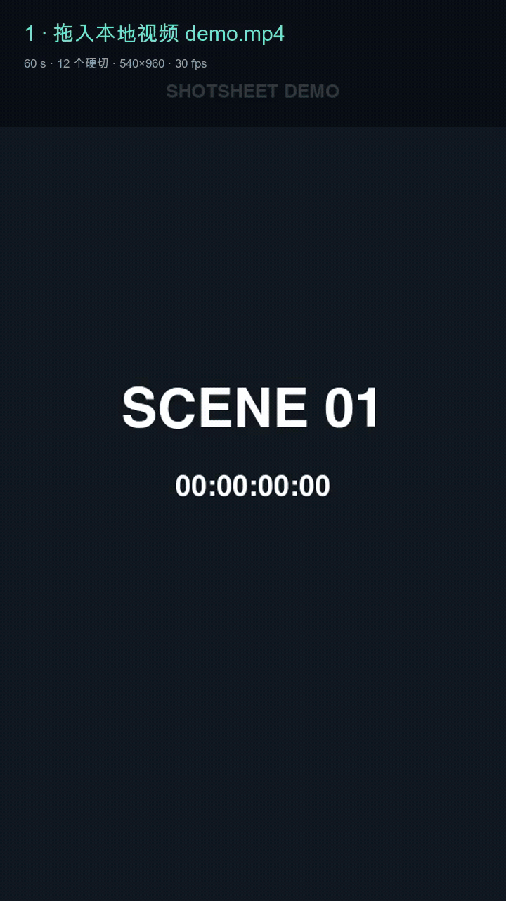

[English](./README.en.md) | **简体中文**

<p align="center">
  <picture>
    <source media="(max-width: 640px) and (prefers-color-scheme: dark)" srcset="assets/hero-mobile-dark.svg">
    <source media="(max-width: 640px)" srcset="assets/hero-mobile-light.svg">
    <source media="(prefers-color-scheme: dark)" srcset="assets/hero-dark.svg">
    
  </picture>
</p>

<p align="center">
  <a href="https://github.com/SuperMarioYL/shotsheet/actions/workflows/ci.yml"></a>
  
  
  
  
</p>

**拉片单（ShotSheet）把一条对标短视频拆成能照拍的分镜表：每镜都有原片时间码、时长、景别、机位、运镜、道具和场景，再按抖音 / 小红书 / 视频号的规则检查字幕安全区与开场钩子，并直接导出一份能进剪映的参考时间线。** 全程在本机跑，不上传视频，不需要登录。

## 为什么做它

照着一条爆款拍第二条，最费时间的不是“看懂”，而是把视频翻译成可执行的拍摄计划。人工做法是暂停、回拖两秒、再暂停，把机位、景别、道具和每镜停多久记下来；一条 60 秒的片子要 1–2 小时，最后得到的还是一页只有自己看得懂的笔记。

逐镜拆解这件事，[rea-video](https://github.com/JuneYaooo/rea-video) 已经先做成了产品。但它的产物 `VIDEO.md` / `report.html` 是写给 Agent 和开发者看的中间格式；创作者拿到手，仍要自己翻译成摄影能照着拍的分镜表。拉片单补的是这一层执行契约：字段固定、每条带 `tc_in`、平台规则有 id、同一套字段可以沉淀成可复用的 Skill 与模板。拆解是别人先做的，我们认；我们多做的是三平台规则、可逐帧对账的时间码，以及剪映工程导出。

## 快速开始

从全新 clone 开始，不需要准备素材：下面的命令会生成一条 6 秒、3 个硬切的竖屏测试片。

```bash
git clone https://github.com/SuperMarioYL/shotsheet.git
cd shotsheet
uv sync

# 生成 3 个镜头的测试片（需要 ffmpeg 命令行）
ffmpeg -y \
  -f lavfi -i "color=c=0x101820:s=540x960:d=2:r=30" \
  -f lavfi -i "color=c=0xf2b134:s=540x960:d=2:r=30" \
  -f lavfi -i "color=c=0x17365f:s=540x960:d=2:r=30" \
  -filter_complex "[0:v][1:v][2:v]concat=n=3:v=1:a=0" \
  -pix_fmt yuv420p demo.mp4

# 切镜、时间码、平台规则，写出 shots.json 与可打印的 shots.html
uv run shotsheet analyze demo.mp4 --platform douyin -o shots.json
```

终端会打印 `3 shots -> shots.json`。用浏览器打开同目录的 `shots.html`，就是 A4 分镜表。

再打开本地单页界面：

```bash
uv run shotsheet serve
# 浏览器访问 http://127.0.0.1:8787
```

页面里可以直接改景别、机位、运镜、道具与场景，改动立即写回 `shots.json`。勾选视觉描述需要火山方舟或阿里云百炼的 Key（`ARK_API_KEY` / `DASHSCOPE_API_KEY`），也可以在页面里临时粘贴；不勾选也能只用切镜与规则校验。

## 演示

<p align="center">
  
</p>

上面这支 16 秒 GIF 来自一次真实运行：一条 60 秒、12 个硬切的合成竖屏片源，跑 `analyze` 得到 12 镜，第 1 镜因超过抖音 3 秒钩子窗口收到 1 条警告；随后 `export` 写出 12 个视频段、共 60,000,000 µs 的剪映 draft。GIF 用真实产物（片源帧、`shotlist.html`、`export --dry-run` 输出、实际写入的 draft 目录）合成，不是屏幕录制。

完整命令、输入生成方式、输出计数和限制都记录在 [docs/demo-results.json](docs/demo-results.json)。

## 架构

<p align="center">
  <picture>
    <source media="(max-width: 640px) and (prefers-color-scheme: dark)" srcset="assets/architecture-mobile-dark.svg">
    <source media="(max-width: 640px)" srcset="assets/architecture-mobile-light.svg">
    <source media="(prefers-color-scheme: dark)" srcset="assets/architecture-dark.svg">
    
  </picture>
</p>

单进程、单目录、无数据库。每个任务一个临时工作目录，跑完可删。

- `pipeline/analyze.py`：`ffprobe` 读时长与帧率，`scenedetect` 找镜头边界，可选 `faster-whisper` 转写字幕。
- `pipeline/describe.py`：逐镜抽帧，调用 OpenAI 兼容的视觉接口填景别/机位/运镜/道具/场景，默认豆包，可切通义千问 VL。
- `pipeline/rules.py`：只读 `rules/cn-platforms.yaml`，校验时长、开场钩子与计划字幕区，不硬编码平台数字。
- `render/shotlist_html.py`：A4 分镜表，保留时间码、字幕、规则三列；网页内联编辑复用同一份表格标记。
- `render/jianying.py`：把 `tc_in` / `tc_out` 换算成微秒，生成剪映 draft 工程目录。

## 处理流程

<p align="center">
  <picture>
    <source media="(max-width: 640px) and (prefers-color-scheme: dark)" srcset="assets/process-mobile-dark.svg">
    <source media="(max-width: 640px)" srcset="assets/process-mobile-light.svg">
    <source media="(prefers-color-scheme: dark)" srcset="assets/process-dark.svg">
    
  </picture>
</p>

每一段都产出可检查的文件，而不是只给一个结尾：`shots.json` 可以 diff，`shots.html` 可以打印，剪映目录可以逐段对回原片。

## 分镜表契约

一份 `ShotSheet` 就是一条视频的拆解记录：

```
ShotSheet
├─ source   file, duration_ms, fps, platform, caption_box
├─ rules    cn-platforms.yaml#douyin | #xiaohongshu | #shipinhao
├─ template 可选的模板 id
└─ shots[]
   ├─ index, tc_in "00:00:03:12", tc_out, duration_ms
   ├─ shot_size 特写|近景|中景|全景|远景
   ├─ camera    固定|手持|俯拍|仰拍|平视|过肩
   ├─ movement  推|拉|摇|移|跟|无
   ├─ props[], scene
   └─ caption   text, in_ms, out_ms, safe_area_ok
```

两个约束让质量可核验：每条字段都带 `tc_in`，人能跳回原片那一帧对账；整份 sheet 可 diff，同一条视频改一版，差异直接看得出来。

## 能力与集成

<p align="center">
  <picture>
    <source media="(max-width: 640px) and (prefers-color-scheme: dark)" srcset="assets/capabilities-mobile-dark.svg">
    <source media="(max-width: 640px)" srcset="assets/capabilities-mobile-light.svg">
    <source media="(prefers-color-scheme: dark)" srcset="assets/capabilities-dark.svg">
    
  </picture>
</p>

| 能力 | v0.1 状态 | 说明 |
| --- | --- | --- |
| 本地文件分析 | 已实现 | mp4 / mov / mkv；v0.1 不下载抖音、小红书、视频号链接 |
| 镜头切分与时间码 | 已实现 | `scenedetect` + 真实帧率换算，`tc_in` 可回查原片 |
| 本地 ASR 字幕 | 已实现 | `--transcribe`，首次会下载 faster-whisper 模型 |
| 逐镜视觉描述 | 已实现 | 豆包 `doubao-seed-2-1-pro-260915`，可切通义 `qwen3-vl-plus` |
| 三平台规则 | 已实现 | 时长上限、开场钩子、计划字幕区；规则唯一来源是 YAML |
| 网页内联编辑 | 已实现 | 改动立即写回 `shots.json`，重新跑规则 |
| A4 分镜表 | 已实现 | `shots.html`，A4 打印版式 |
| 剪映 draft 导出 | 已实现 | 明文 `draft_content.json`，每镜一段，微秒时间码 |
| 批量队列 / 共享模板 / 多账号 | 未实现（v0.2 路线） | 见「付费」 |

## 平台规则与字幕安全区

`src/shotsheet/rules/cn-platforms.yaml` 是平台规则的唯一来源。时长上下限引用平台公开规则页；开场钩子与字幕安全区是社区长期观察的区间，文件里标为 `heuristic`，不是平台公布的精确规范。

计划字幕区默认是 `top 72% / bottom 80% / left 6% / right 88%`，一个 8% 高的横条。这个默认值同时落在抖音、小红书、视频号三套 UI 边距之内，因此不会在默认情况下报越界。CLI 和网页都可以改：

```bash
uv run shotsheet analyze demo.mp4 --platform xiaohongshu --caption-box 70,80,8,86
uv run shotsheet rules shots.json --caption-box 88,100,4,96   # 越界示例，会报错
```

诚实说明：v0.1 无法识别已经烧进画面里的字幕。安全区校验的对象是 `source.caption_box` 这块**计划**字幕区，而不是原片文字的实际包围盒。规则 id 写成 `planned_caption_safe_area` 就是为了不造成误解。

## 导出剪映

```bash
# 先看计划：画布、轨道、每段的 timeline / source 时间码，不写文件
uv run shotsheet export shots.json --jianying-dir ./jianying --dry-run

# 真正写出 draft 目录，并把源片路径嵌进素材
uv run shotsheet export shots.json --jianying-dir ./jianying --video demo.mp4
```

输出是一个剪映 draft root：

```
jianying/
├─ root_meta_info.json
└─ demo-shotsheet/
   ├─ draft_content.json
   └─ draft_meta_info.json
```

把 `<draft-name>` 目录复制进剪映的 `com.lveditor.draft` 目录，并把 `root_meta_info.json` 里的 `all_draft_store` 条目合并进该目录的同名文件，即可注册工程。也可以直接把 `--jianying-dir` 指向 `com.lveditor.draft`：工具会按 draft id 合并 `root_meta_info.json`，不会清掉已有工程；如果同名目录里已经是另一个 draft id，导出会拒绝覆盖并提示换一个 `--draft-name`。草稿里每个镜头一段，`target_timerange` 与 `source_timerange` 都以微秒记录；没有字幕时只有视频轨，有 ASR 字幕时追加一条文字轨，并按计划字幕区放置。

**目标版本**：明文 `draft_content.json`，`version: 360000`、`new_version: "75.0.0"`，对应剪映专业版 5.x/6.x 读取的格式。**剪映 10.1 把时间线存进加密的 `draft_info.json`，本工具不写、不解密这个文件**，因此不要把这份明文工程当成 10.1 可直接导入的工程。本次构建没有在运行中的剪映里做导入实测，兼容性说明见 [docs/demo-results.json](docs/demo-results.json)；切点对齐是按 `tc_in`/`tc_out` 逐段换算微秒得到的，不依赖估计。

## 付费

v0.1 的本地单机版不设付费墙，MIT 开源，拉片、规则校验和导出都可以直接用。收费的是给团队与 MCN 的 v0.2 团队版：

| 方案 | 价格 | 包含 |
| --- | --- | --- |
| 本地版 v0.1 | 免费 | 单机分析、逐镜编辑、三平台规则、HTML 与剪映导出 |
| 团队版 v0.2 | ¥299 / 月 / 团队 | 5 个席位、500 条/月、批量队列（20 条/次）、共享模板库、多账号并行 |
| 团队版年付 | ¥2,990 / 年 | 同上，超出部分 ¥0.6 / 条 |
| 试点代拆 | ¥1,500 / 次 | 用你们的 10 条爆款做一次批量代拆，交付分镜表 HTML + 剪映工程 |

团队版部署在腾讯云轻量 2C4G 上，走微信支付商户号收款。最小成交路径不是让团队先注册 SaaS，而是先把这批片子拆完、确认能拍，再谈私有部署或按月续用。v0.1 不出售账号体系、云端上传或模板市场；这些承诺留到 v0.2 真正实现时再说。

## 路线图

- **v0.1（当前）**：本地切镜、时间码、可选 ASR、逐镜视觉描述、三平台规则、网页内联编辑、A4 分镜表、剪映明文 draft 导出。
- **v0.2（规划，未实现）**：批量队列（20 条/次）、共享模板库、MCN 多账号并行、托管上传；对应上面的团队版价格。
- **暂不承诺**：从平台链接直接下载、BGM/卡点分析、自动套剪映特效与转场、模板市场。v0.1 的边界就是本地文件进、可拍物料出。

## 已知限制

- 视觉模型的景别、机位、道具判断会错。所以每个单元格都能改，每条都能回查 `tc_in`；价值是把 1–2 小时的逐帧暂停降到 10 分钟核对，不是替代创作者判断。
- v0.1 只吃本地文件，不处理平台链接下载与合规问题。
- 无法定位原片里已经烧进画面的字幕；字幕安全区只校验计划字幕区。
- 剪映导出面向明文 `draft_content.json` 的版本；10.1 的加密 `draft_info.json` 不在范围内。
- 平台规则里的钩子窗口与安全区是社区经验值，平台改版后需要改 YAML；`duration_s` 来自公开规则页，但发布时仍以发布页提示为准。

## 开发

```bash
uv sync --extra dev
uv run ruff check .
uv run ruff format --check .
uv run pytest
```

测试覆盖 schema、时间码换算、ASR 合并、平台规则、网页写入、剪映 JSON 结构、微秒时间码与确定性输出；视频相关测试用 ffmpeg 生成小片源，缺 ffmpeg 时跳过。

<p align="center"><sub><a href="./LICENSE">MIT</a> © 2026 SuperMarioYL</sub></p>
